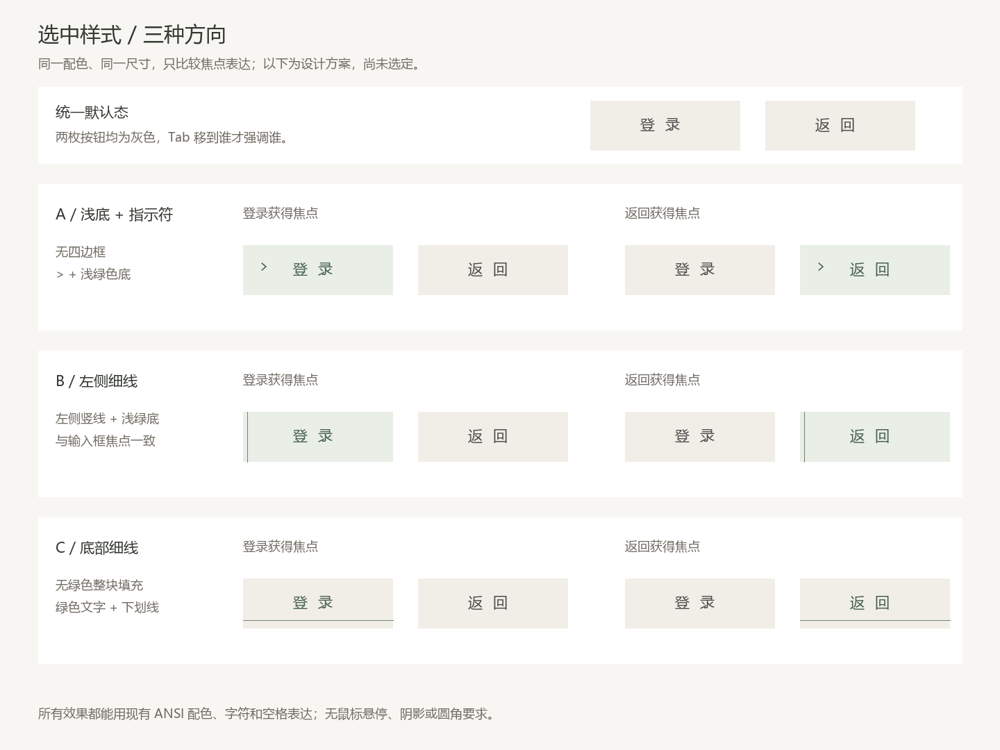
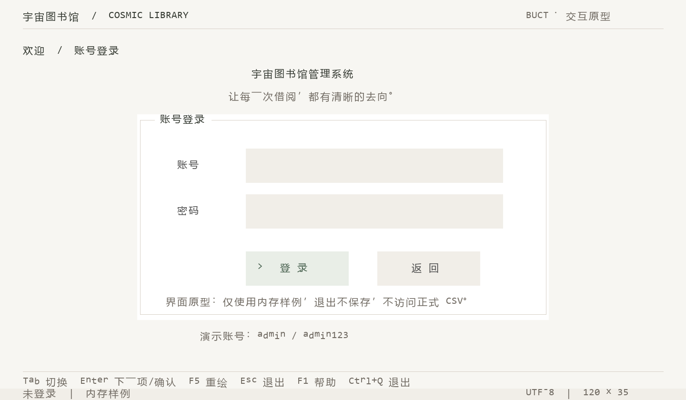

> 历史记录说明（2026-10-22）：本文涉及的 Python/PowerShell/.NET 工具仅留本地，已从当前仓库取消跟踪，旧启动与单写者保护说明已被[纯 C 启动流程](../纯C启动与仓库边界.md)取代；历史测试结果仅对应当时版本。

# 按钮焦点样式：已选 A

日期：2026-10-21。保持 120×35、现有布局与暖调色板，只比较按钮获得键盘焦点时的视觉表达。

## 已确定并实施的规则

登录、返回、保存、取消均采用相同的焦点配色逻辑：未获得焦点时为暖灰底 `#f1eee8`、正文灰 `#4e4e4e`；只有 Tab/方向键选中的控件才变色。登录和保存不再因为是主要操作就一直为绿色。

初始焦点仍在账号字段；因此初始账号可显示输入焦点，登录与返回均为灰色。返回获得焦点时也使用与登录相同的选中色，移走焦点立即恢复灰色。

现有 C 原型已实施这条规则，61 项检查通过，并核对了实际 C 输出复现图中两枚按钮初始底色。用户已选择方案 A，现已接入：浅绿底、绿字、左侧 >，无包围边框。登录、返回、保存、取消共用该绘制逻辑。

## 方案对比（A 已采用）

| 方案 | 获得焦点后的表达 | 取舍 |
| --- | --- | --- |
| A：浅底与指示符 | 浅绿底、绿字、左侧 `>`，无包围边框 | 焦点醒目，与列表的指示符呼应 |
| B：左侧细线 | 浅绿底、绿字、左侧一条竖线，无包围边框 | 保留备选，未采用 |
| C：底部细线 | 保持暖灰底，绿色文字加一条底线 | 视觉最轻，选中区别较克制 |

三个方案尺寸相同，所有效果都能以现有字符、ANSI 颜色和空格绘制；不依赖鼠标、图片、圆角或阴影。图为代码生成的设计对比，不是 C 运行截图，也不表示三个版本已经接入运行开关。

对比图由 `tools/design/render_focus_options.py` 生成，属于离线设计工具，该脚本已于 2026-10-22 从仓库取消跟踪、仅留本地。当前已将 A 落实到 C 控件；其他方案只作对比留存。

## 方案 A 的 C 输出复现

该图直接复现 C 程序在登录按钮获得焦点时的输出，不是终端截图；未选中的返回保持灰色。
