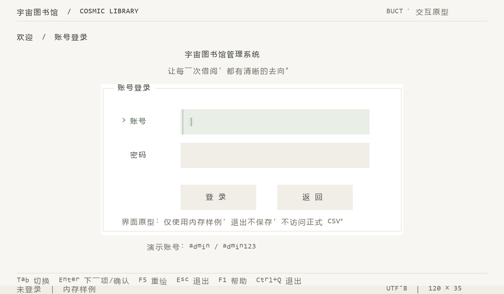
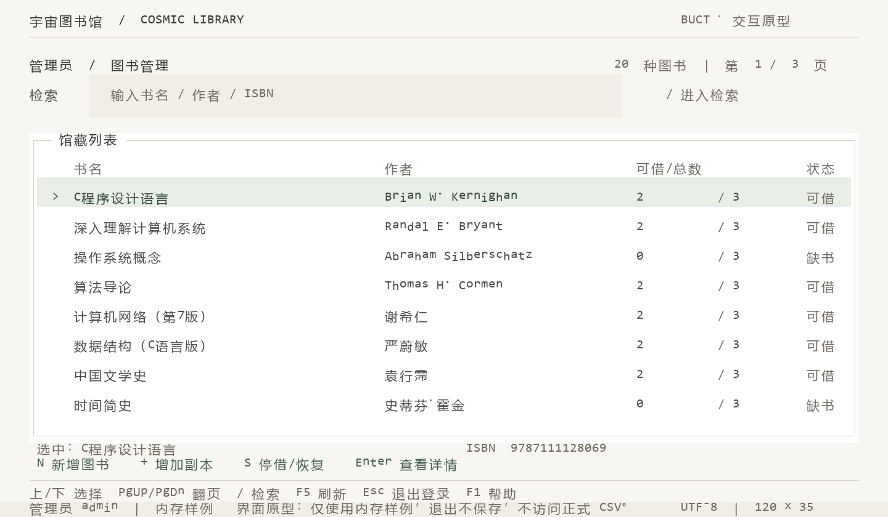
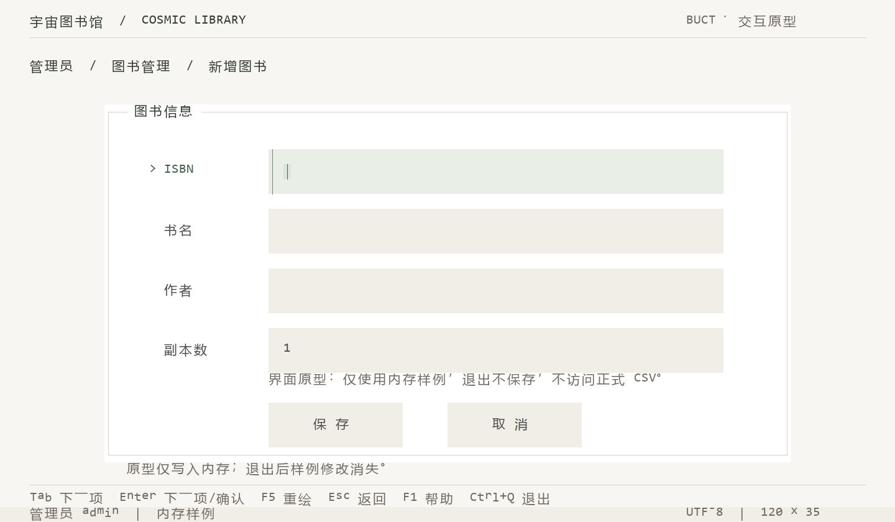

> 历史记录说明（2026-10-22）：本文涉及的 Python/PowerShell/.NET 工具仅留本地，已从当前仓库取消跟踪，旧启动与单写者保护说明已被[纯 C 启动流程](../纯C启动与仓库边界.md)取代；历史测试结果仅对应当时版本。

# 页面草图与实现边界

更新：2026-10-21。当前布局 **120 列 × 35 行**，按用户最新反馈从 120×40 收短纵向空间，宽度、暖调配色和每页 8 条保持不变。120×35 优先于此前 3:2 目标；不再宣称画面严格为 3:2。

以下图片来自独立 C 原型的实际 ANSI 输出复现，均为 1440×840，不是终端窗口截图。字符网格与运行原型使用同一绘制代码，减少草图和实现不同步的问题。

## 三页预览

### 登录

[字符网格](login.txt)。表单上移三行，标题与副标题上移两行；保持三行输入区、主按钮和返回按钮，压缩表单外部的上下空白。

### 图书管理

[字符网格](books.txt)。每页仍为 8 条，书名 38 列、作者 31 列，保留记录间留白。检索区和列表上移；列表下方显示选中图书及主要操作，操作反馈并入底部状态栏。

### 新增图书

[字符网格](book-form.txt)。保留 ISBN、书名、作者、副本数四个字段，三行高输入区以及单独的校验提示和按钮区域；整体上移并减少边缘空白。图中是空表单状态，输入校验与错误保留内容由原型和测试覆盖。

## 当前行坐标（从 1 开始）

| 区域 | 行 |
| --- | --- |
| 品牌与分隔线 | 2、3 |
| 当前位置 | 5 |
| 登录标题、副标题 | 7、9 |
| 登录表单 | 11～28 |
| 登录账号、密码输入区 | 14～16、18～20 |
| 登录按钮与表单说明 | 23～25、27 |
| 演示账号提示 | 30 |
| 图书检索输入区 | 6～8 |
| 图书列表与表头 | 10～30、12 |
| 图书记录 | 14、16、18、20、22、24、26、28 |
| 选中图书、业务操作 | 31、32 |
| 新增图书面板 | 8～31 |
| 新增图书输入区 | 11～13、15～17、19～21、23～25 |
| 新增图书提示与按钮 | 26、28～30 |
| 全局分隔、快捷键、状态栏 | 33、34、35 |

普通中文按两列、ASCII 与框线按一列处理。长书名和作者按列宽安全截断，不切碎 UTF-8 字符。固定布局不会随终端放大自动拉伸。

## 配色

参考用户指定的 `C:\Users\MECHREVO\dsh-raw-html-v2\styles\warm-minimal.md`，并借鉴 [Radix 颜色层级](https://www.radix-ui.com/colors/docs/palette-composition/understanding-the-scale)和[主题中性色](https://www.radix-ui.com/themes/docs/theme/color)的分层思路；以下色值是本项目调整后的方案，不是照搬官方色阶。

| 用途 | 色值 |
| --- | --- |
| 暖白背景、白色内容区 | `#f7f6f2`、`#ffffff` |
| 暖石底色 | `#f1eee8` |
| 标题、正文、次要文字 | `#353a32`、`#4e4e4e`、`#716b63` |
| 普通边框 | `#d8d0c7` |
| 选中背景、编辑光标底色 | `#e9eee7`、`#dce5d9` |
| 选中行文字、焦点文字与竖线 | `#344c3d`、`#48614f`、`#6f856f` |
| 错误提示 | `#a34b3b` |

按钮未获得焦点时统一为暖灰底、灰色字；只有选中后才变色，不再常驻浅绿色。初始焦点在账号字段，登录与返回均为灰色。用户已选定并接入[方案 A](选中样式方案.md)：浅绿底、绿色文字和左侧 >，不再绘制包围边框。错误含明确文字，不依赖颜色单独传达。只使用字符、空格、ANSI 真彩色，不要求图片、圆角、阴影或网页字体。

## 教材与实现范围

已核对用户提供的附录 C 五张截图，以及教材印刷页 42、64、87、185（PDF 页 55、77、100、198），确认输入输出及正文补充函数的依据。函数范围见[课程允许函数清单](../课程允许函数清单.md)。ANSI 输出沿用此前项目已确认的口径，不是新增教材 API。

独立原型已支持演示登录、普通中文/ASCII 编辑、密码遮挡、列表翻页、检索、内存新增、校验与放弃确认。F5 可在所有页面完整重绘；平时只输出变化行。启动脚本检查实际可见窗口至少为 120×35，不通过 C 中的 Win32 API 修改窗口。

当前不是响应式界面。运行中调整窗口或字号后按 F5；Emoji、组合字符、真实输入法候选窗和不同字体的视觉效果仍需进一步人工确认。原型不接入正式 CSV、认证、借还和跨进程同步。

[使用说明](../../tools/preview/README.md) · [原型验证记录](原型验证记录.md)

设计刷新脚本 `tools/design/render_wireframes.py` 调用当前 C 原型生成字符网格与图片，仅为离线辅助工具，不进入纯 C 应用的构建与运行依赖。当前 61 项检查通过，三页网格均为 120×35，图片已逐张检查；未修改正式业务数据，未推送 Git。
